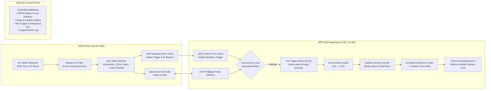

# 🎃 Halloween Interactive Kiosk & ESP32 Door Node

An automated, ultra-reliable interactive Halloween scare system connecting an **ESP32 ultrasonic door sensor** with a **fullscreen Windows kiosk application** (.NET 10 WPF) and perpetual ambient audio engine.

When visitors push open the door, the ESP32 instantaneously detects the movement and transmits UDP trigger packets over Wi-Fi. The kiosk waits for a configurable pre-activation delay (allowing the visitor to walk through the doorway), ducks the background ambient loop, forces the interactive poster overlay above PowerPoint presentations, and screams a randomized non-repeating voice alert before cleanly returning to ambient mode.

---

## 🏛 System Architecture



---

## 🌟 Key Features

### 📡 ESP32 Door Node (`hloween_door`)
- **Ultrasonic Accuracy & Stuck-Echo Recovery**: Median-of-3 filtering completely rejects acoustic bounce anomalies. Features an automated 500µs echo-line grounding routine to clear latched HC-SR04 sensors.
- **Hysteresis State Machine**: 8cm deadband (`>22cm` open, `<14cm` closed) with 2-sample confirmation (~150ms) filters door vibration and stops false triggers.
- **Dual Networking Modes**:
  - **Dev Mode (`isDev = true`)**: Connects to local Wi-Fi station with automatic non-blocking reconnection and dual broadcast delivery (`255.255.255.255` + subnet broadcast).
  - **Production Mode (`isDev = false`)**: Runs a standalone, isolated SoftAP (`Halloween_Door` / `spooky2026`) on static IP `192.168.4.1` with TX power tuned to 11dBm (runs completely cool to the touch).
- **Self-Healing Safeguards**: 15-second hardware task watchdog (`esp_task_wdt`) and an automated RAM monitor that reboots the MCU if free heap drops below 40KB during door idle.
- **Integrated Web UI**: Navigate to the ESP32's IP address in any browser for live telemetry, distance readings, and a manual test button.

### 🖥 WPF Kiosk & Audio Overlay (`hlo_ui`)
- **Perpetual Looping Audio Engine**: Powered by NAudio (`LoopStream` + `VolumeSampleProvider` + `WaveOut`) for gapless playback of the 44-minute ambient audio loop.
- **Audio Watchdog**: Automatically catches audio driver interruptions, USB DAC resets, or HDMI monitor sleep and re-establishes playback instantly.
- **Configurable Pre-Trigger Delay**: Configurable slider (`0.0s` to `5.0s`, default `2.5s`) allows visitors to cross the threshold and face the display before the scare begins.
- **Intelligent Audio Ducking**: Smoothly attenuates ambient background audio from `0.6` down to `0.15` when a voice alert plays, restoring full volume once the alert concludes.
- **Randomized Non-Repeating Alerts**: Dynamically pulls all audio files from `Assets/alerts/` and plays alerts in a randomized sequence with zero immediate repeats.
- **PowerPoint Lock Defeat**: Utilizes Win32 `SetWindowPos(HWND_TOPMOST)` and `SetForegroundWindow` to guarantee the kiosk appears on top of running fullscreen PowerPoint presentations.
- **Operator Dashboard**: Dedicated control panel displaying live ESP32 IP, distance (cm), door state (OPEN/LATCHED), trigger counts, adjustable sliders, and an auto-scrolling event log (capped at 1,000 lines for memory safety).

---

## 🔌 Hardware Wiring (ESP32 DevKit 30-Pin)

| HC-SR04 Pin | ESP32 Pin | Description |
| :--- | :--- | :--- |
| **VCC** | **VIN / 5V** | 5V Power Supply |
| **GND** | **GND** | Ground |
| **TRIG** | **GPIO 26** | Trigger pulse output |
| **ECHO** | **GPIO 27** | Echo pulse input *(via 1k/2k resistor divider or direct 3.3V tolerant pin)* |
| **LED** | **GPIO 2** | Built-in Blue LED (Solid = Ready, Blinks on Trigger/Connecting) |

---

## 🚀 Getting Started

### 1. ESP32 Firmware Setup (`hloween_door`)
Requires [PlatformIO](https://platformio.org/) (VS Code extension or CLI).

1. Open `hloween_door/src/main.cpp`.
2. Configure your mode on line 14:
   ```cpp
   const bool isDev = true; // Set to true for home Wi-Fi; false for standalone AP
   ```
3. Compile and upload to your ESP32:
   ```bash
   pio run -t upload
   ```

### 2. WPF Kiosk Application Setup (`hlo_ui`)
Requires [.NET 10 SDK](https://dotnet.microsoft.com/download/dotnet/10.0) on Windows.

1. Navigate to the `hlo_ui` directory:
   ```powershell
   cd hlo_ui
   ```
2. Run in development mode:
   ```powershell
   dotnet run
   ```

---

## 🎛 Operator Controls & Shortcuts

| Action | Control / Shortcut | Description |
| :--- | :--- | :--- |
| **Dismiss Active Alert** | `Escape` | Immediately aborts active voice alert or pending trigger countdown and returns to ambient mode. |
| **Emergency Shutdown** | `Ctrl + Q` | Cleanly terminates all audio streams, UDP sockets, and closes both windows. |
| **Manual Test Alert** | Button: `⚡ Test Alert Popup` | Immediately launches the fullscreen poster and random voice alert (`applyDelay: false`). |
| **Auto Demo Mode** | Checkbox: `Enable Auto Demo Timer` | Automatically triggers the kiosk alert every 15 seconds for demonstration purposes. |
| **Adjust Pre-Delay** | Slider: `Door Trigger Activation Delay` | Adjusts visitor entry delay from `0.0s` to `5.0s` (in `0.5s` steps). |
| **Adjust Display Time** | Slider: `Minimum Alert Display Duration` | Adjusts poster display duration from `4s` to `30s` (speech audio naturally extends this if longer). |

---

## 📦 Hot-Swappable Asset Architecture

The build is designed so audio and visual assets can be swapped without recompiling the executable:

```text
HalloweenKiosk-Windows-x64/
├── HalloweenKiosk.exe          # Self-contained, single-file Windows x64 binary
└── Assets/
    ├── ambient_loop.mp3        # Continuous background ambient soundtrack
    ├── poster.png              # 1080p fullscreen Halloween graphic
    └── alerts/                 # Voice alert scream files (*.wav, *.mp3, *.aac)
        ├── 1.wav
        ├── 2.wav
        ├── 3.wav
        └── 4.wav
```

---

## 🛠 CI/CD & Automated Releases

This repository includes a GitHub Actions workflow (`.github/workflows/build-kiosk.yml`):
- **On Push to `main`**: Compiles a self-contained single-file binary and uploads a test artifact.
- **On Version Tag (`v*`)**: Automatically compiles, packages `Assets/`, and attaches `HalloweenKiosk-Windows-x64.zip` to a new [GitHub Release](https://github.com/Danushka-Madushan/hloween/releases).

---

## 📄 License
Created for community Halloween interactive displays. Open source under the MIT License.
